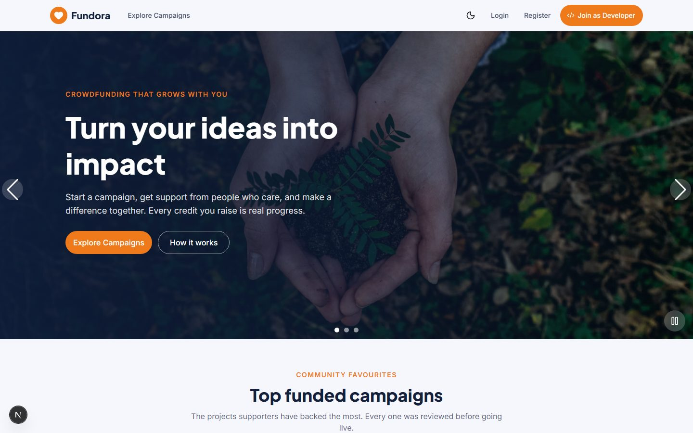
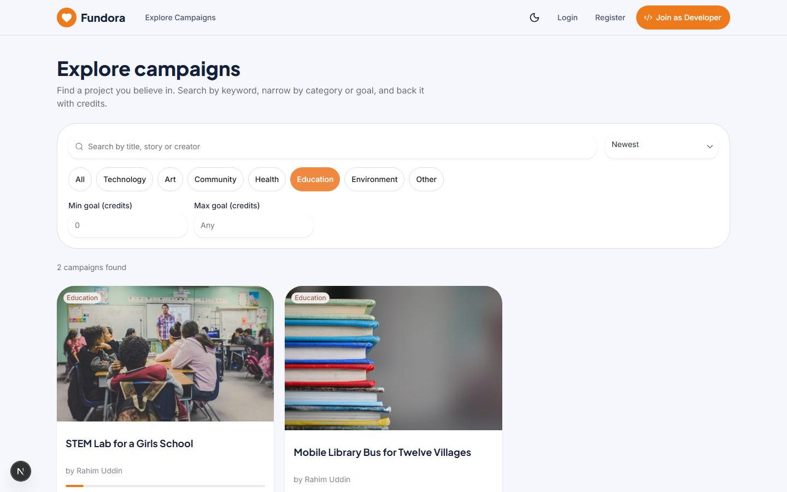
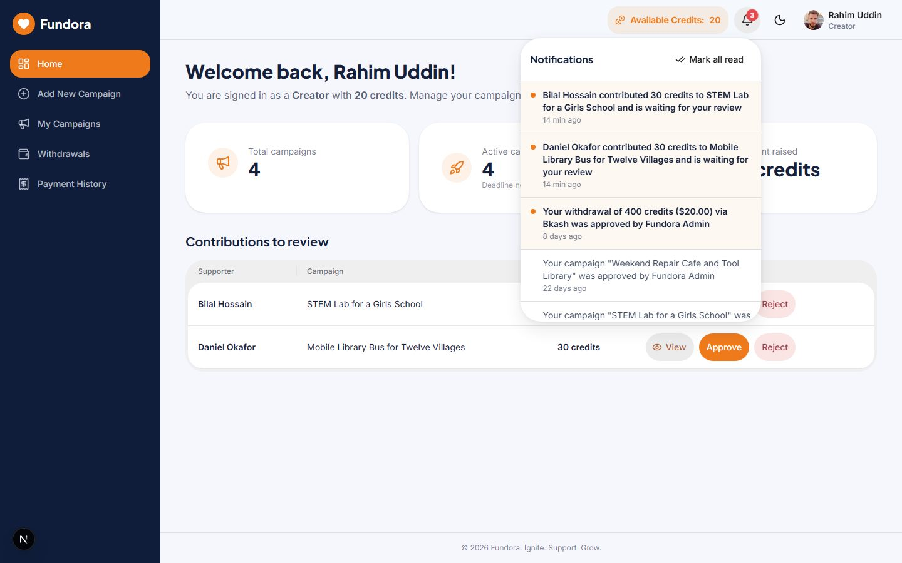
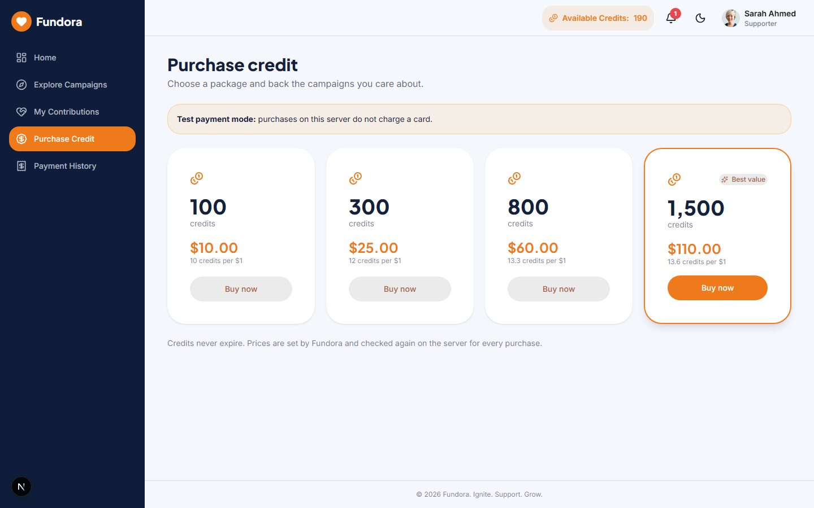
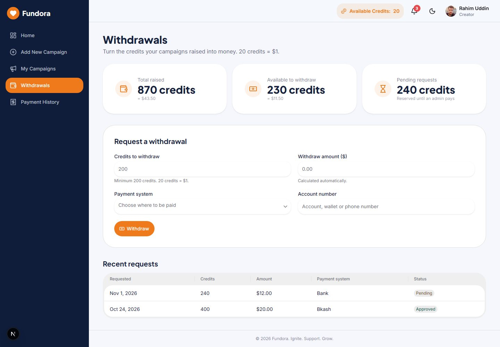
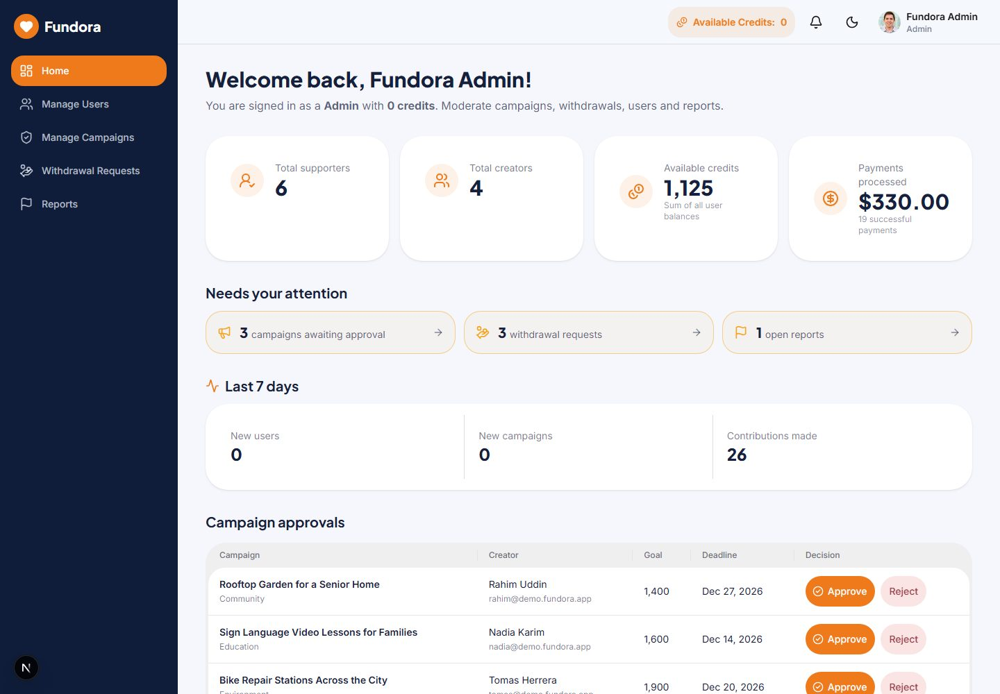
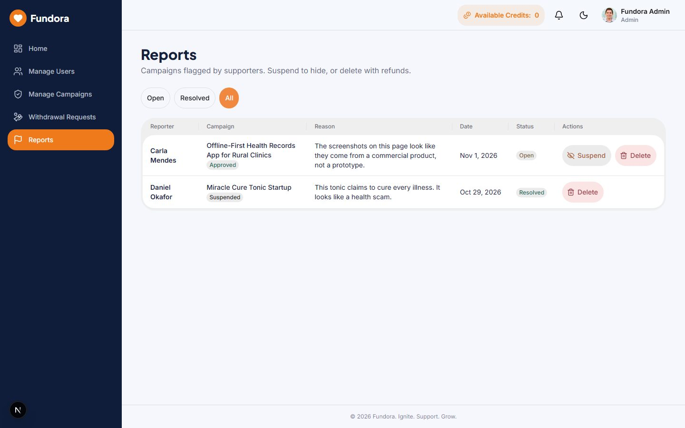
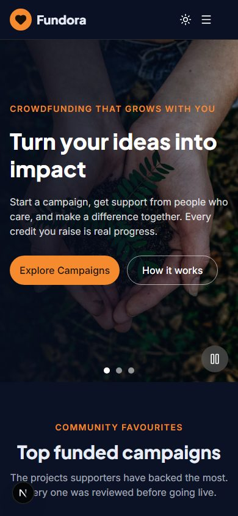

# Fundora

**Turn your ideas into impact.** Fundora is a full-stack crowdfunding platform where creators launch campaigns,
supporters back them with platform credits, and admins keep everything honest. This is the Next.js client; the API lives in
the sibling `server/` repository.

| | |
| --- | --- |
| **Website name** | Fundora |
| **Live site** | `https://<your-client>.vercel.app` (fill in after deploying, see [Deployment](#deployment)) |
| **Admin email** | `admin@fundora.app` |
| **Admin password** | `Admin@12345` (demo default created by `npm run seed`; set `SUPER_ADMIN_PASSWORD` on a public deployment) |
| **Demo creator / supporter** | `rahim@demo.fundora.app` / `sarah@demo.fundora.app`, password `Demo@12345` |

## Screenshots

| Home | Explore |
| --- | --- |
|  |  |

| Creator dashboard and notifications | Purchase credits |
| --- | --- |
|  |  |

| Withdrawals | Admin home |
| --- | --- |
|  |  |

| Reports moderation | Mobile (dark theme) |
| --- | --- |
|  |  |

## Features

- **Three role-based dashboards** (supporter, creator, admin) with a sidebar that becomes a drawer on mobile, enforced on the client
  and again on every API route
- **Atomic credit accounting:** contributions are debited immediately, approved or rejected once, and refunded exactly once,
  including when a campaign is deleted
- **Stripe credit purchases** with Stripe Elements, a server-verified and idempotent confirm, a signed webhook and a
  clearly labelled test-payment mode for local work
- **Creator withdrawals** (20 credits = $1, minimum 200) with reserved credits and admin "Payment Success" approval
- **Campaign lifecycle:** creators submit, admins approve or reject, supporters report, admins suspend or delete with refunds
- **Server-side search, category filter, goal range, sort and pagination** on Explore, in sync with the URL category links
- **Notification bell** with unread badge and a floating popover (newest first, closes on outside click, marks read and
  navigates), refreshed by polling and on window focus
- **JWT authentication** stored in localStorage and sent by an axios interceptor; reloading any private route keeps you logged in
- **Google sign-in** (Firebase) with a role picker for first-time users; registration bonus granted exactly once
- **imgBB image uploads** with preview, type and size checks and a URL fallback
- **Animated home page:** Swiper hero (3 banners, autoplay with a pause control), scroll reveals, animated counters from live
  statistics, testimonials slider, FAQ accordion and category cards; all animation respects `prefers-reduced-motion`
- **Responsive, accessible UI built with HeroUI v3:** light and dark themes without a flash on load, 44px touch targets, visible
  focus rings, labelled controls, skeleton loaders, empty and error states, custom 404 and error pages
- **Admin moderation:** manage users (role changes with last-admin and self protections), manage campaigns, withdrawal queue and reports

## Tech stack

Next.js 16 (App Router, JavaScript), React 19, HeroUI v3 on Tailwind CSS v4, framer-motion, Swiper, axios, React Hook Form +
Zod, Stripe.js (`@stripe/react-stripe-js`), Firebase Auth (Google only), lucide-react and react-icons. Fonts via `next/font`
(Plus Jakarta Sans for headings, Inter for body). Server: Express 5, MongoDB, Zod, JWT, bcryptjs, Stripe, firebase-admin.

## Getting started

Prerequisites: Node 22, a running API (see `server/README.md`).

```bash
npm install
cp .env.example .env.local     # then fill in the values (names only are committed)
npm run dev                    # http://localhost:3000
```

For a quick local backend: in `server/` run `npm run dev:db` (throwaway MongoDB), put the printed URI in `server/.env`, then
`npm run seed` and `npm run dev`.

### Environment variables

`NEXT_PUBLIC_*` values are baked into the bundle at **build time**, so redeploy after changing them.

| Name | Description |
| --- | --- |
| `NEXT_PUBLIC_API_URL` | Base URL of the API, no trailing slash (for example `https://fundora-api.vercel.app`) |
| `NEXT_PUBLIC_CLIENT_REPO_URL` | GitHub URL of this repo, used by the "Join as Developer" button |
| `NEXT_PUBLIC_FIREBASE_API_KEY`, `NEXT_PUBLIC_FIREBASE_AUTH_DOMAIN`, `NEXT_PUBLIC_FIREBASE_PROJECT_ID`, `NEXT_PUBLIC_FIREBASE_APP_ID` | Firebase web app config for Google sign-in |
| `NEXT_PUBLIC_STRIPE_PUBLISHABLE_KEY` | Stripe publishable key (test mode) for Stripe Elements |
| `NEXT_PUBLIC_IMGBB_KEY` | imgBB API key for profile and campaign image uploads (URL fields work without it) |
| `NEXT_PUBLIC_SOCIAL_LINKEDIN`, `NEXT_PUBLIC_SOCIAL_FACEBOOK`, `NEXT_PUBLIC_SOCIAL_GITHUB` | Footer social links |

### Scripts

| Script | Purpose |
| --- | --- |
| `npm run dev` | Development server |
| `npm run build` / `npm start` | Production build and server |
| `npm run lint` | ESLint |

## Credits business rules

- **Registration bonus:** a supporter gets **50 credits** and a creator **20**, once, when the account is created. A first Google
  sign-in earns the same bonus exactly once; later logins never do.
- **Credit packages** (prices are fixed on the server): **100 credits = $10, 300 = $25, 800 = $60, 1500 = $110**.
- **Contributions:** the amount must be at least the campaign minimum and no more than the supporter's balance. It leaves the
  balance immediately and is held as pending. The creator approves it (it counts toward the raised total) or rejects it (full
  refund). Deleting a campaign refunds every pending and approved contribution.
- **Withdrawals:** **20 credits = $1** and the **minimum is 200 credits ($10)**. The dollar amount is computed on the server.
- **Available raised credits** = approved contributions to the creator's campaigns, minus credits in approved withdrawals, minus
  credits in pending withdrawals (pending requests are reserved, so the same credits cannot be requested twice). Approving a
  request turns the reservation into a final deduction.

## API overview

All routes live under `/api` and return `{ success, data, error }`. See `server/README.md` for the full table.

| Area | Examples |
| --- | --- |
| Auth | `POST /auth/register`, `/auth/login`, `/auth/google`, `GET /auth/me` |
| Campaigns | `GET /campaigns`, `/campaigns/top`, `/campaigns/:id`; creator CRUD; admin approve, reject, suspend |
| Contributions | `POST /contributions`, creator `approve` / `reject`, `GET /contributions/campaign/:id/recent` |
| Payments | `GET /payments/packages`, `POST /payments/create-intent`, `/payments/confirm`, `/payments/webhook` |
| Withdrawals | `GET /withdrawals/summary`, `POST /withdrawals`, admin `PATCH /admin/withdrawals/:id/approve` |
| Moderation | `/admin/users`, `/admin/campaigns`, `/admin/reports`, `POST /reports` |
| Other | `GET /notifications`, `GET /stats/me`, `/stats/admin`, `/stats/public` |

## Deployment

Both apps are deployed to Vercel as separate projects.

1. **API:** import the `server/` repo, add the server environment variables, deploy, then `npm run seed` once against the Atlas URI.
2. **Client:** import this repo, add the `NEXT_PUBLIC_*` variables above (with `NEXT_PUBLIC_API_URL` pointing at the API), deploy.
3. Add the client URL to the API's `CLIENT_URL` and redeploy the API; add the client domain to Firebase authorized domains.
4. Verify: `npm run check:deploy -- <apiUrl> <clientOrigin>` in `server/`.

## Decisions and deviations

- **Brand and theme:** the product is named Fundora and uses an orange accent with a deep navy sidebar, following the supplied
  reference design (instead of the emerald/amber palette named in the first brief).
- **Navbar:** HeroUI v3 has no Navbar component, so the sticky navbar and mobile menu are built from HeroUI `Button`,
  `Dropdown` and `Drawer`.
- **Next.js config:** `cacheComponents` (the create-next-app default) is disabled; it keeps previous routes mounted but hidden,
  which caused react-aria label warnings and duplicate landmarks, and this app fetches data on the client anyway.
- **Payments without Stripe keys:** `PAYMENT_MODE=dummy` on the server shows a clearly labelled test-payment dialog that follows
  the same idempotent confirm path. The Stripe Elements card form requires real test keys.
- **Images:** seed data and the home page hotlink Unsplash and randomuser.me images; uploads go straight from the browser to imgBB.
